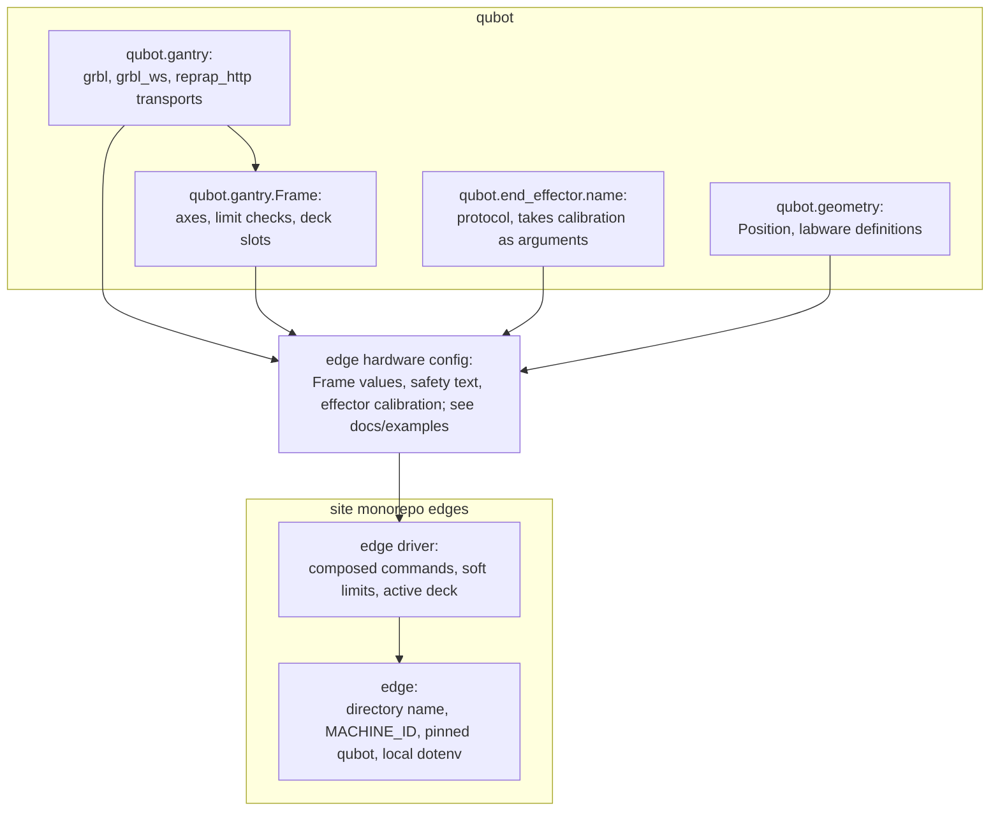

# Modularization

A qubot is one gantry plus the end effectors mounted on it. That combination changes. The capper frame later carried a syringe, and the capper still has to be buildable again.

This repository stores the drivers that can be mixed. It does not store a finished edge. A site monorepo holds only the edges for that site. Each edge depends on `qubot`, imports the gantry transport and end effectors it carries, and constructs them with its own frame travel, soft limits, deck, and calibration. qubot validates those values (`Frame`, effector constructors) but stores none.

Everything is one package, `qubot`. `qubot.gantry` holds the shared transports and the `Frame` type. `qubot.end_effector` holds one module per toolhead. `qubot.geometry` holds position, deck, and labware. `qubot.edgekit` refuses to start an edge until a filled local `.env` exists. Machine ids and host `.env` files belong to the site edge.

`002-1unit-reprap-http` was the capper. A syringe edge mounts `autosampler-syringe` on that same frame. A later edge change can mount the capper again by importing it, without copying the syringe edge.
