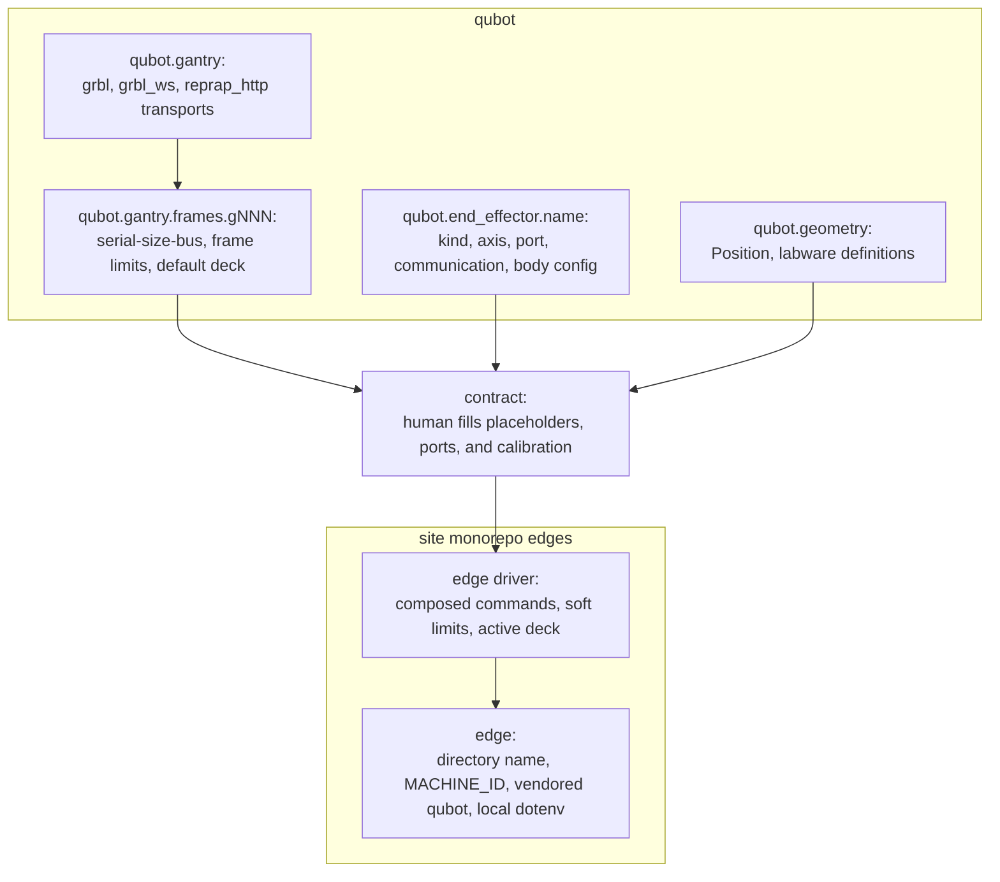

# Modularization

A qubot is one gantry plus the end effectors mounted on it. That combination changes. The capper frame later carried a syringe, and the capper still has to be buildable again.

This repository stores the hardware that can be mixed. It does not store a finished edge. A site monorepo holds only the edges for that site. Filling `CONTRACT.md` and running `scripts/vendor_edge.py` copies the `qubot` package into the edge; the contract picks the gantry and effector modules. Frame travel stays on the gantry. Soft limits and the active deck stay in the edge, so a local limit does not rewrite the frame.

Everything is one package, `qubot`. `qubot.gantry` holds the shared transports and `qubot.gantry.frames` one module per gantry. `qubot.end_effector` holds one module per toolhead. `qubot.geometry` holds position, deck, and labware. `qubot.edgekit` loads a numbered contract and refuses to start an edge until a filled local `.env` exists. Machine ids and host `.env` files belong to the site edge.

`002-1unit-reprap-http` was the capper. A syringe edge mounts `autosampler-syringe` on that same frame. A later contract can mount the capper again without copying the syringe edge.
