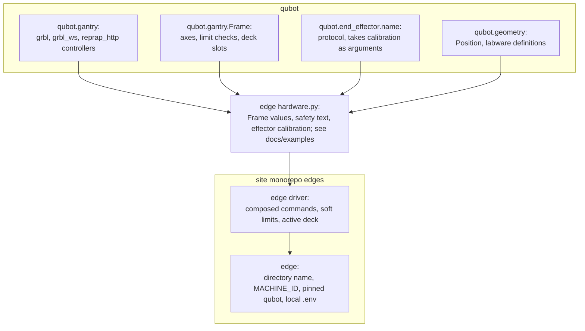

# qubot

One Python package, `qubot`, with the gantry and end-effector drivers for building a PUDA qubot edge. It holds no machine settings: each edge imports the drivers it needs and configures them in its own code. Nothing in this repository is a running edge. Agents start from the [qubot-driver skill](skills/qubot-driver/SKILL.md). The [design](#design) section explains the split. Changes are recorded in [CHANGELOG.md](CHANGELOG.md).

- No `MACHINE_ID`, NATS servers, host addresses, serial-device paths, frame limits, calibration, container config, or `.env`. A site edge's `.env.example` stays placeholders.
- Code lives in `src/qubot/`. One `pyproject.toml` at the root; gantries and end effectors are modules, not separate packages.
- `qubot.gantry.grbl`, `qubot.gantry.grbl_ws`, `qubot.gantry.reprap_http` are the transports, shared by every gantry.
- `qubot.gantry.Frame` holds one machine's axes, hardware limits, default deck, and optional home order and firmware checks. It refuses limits outside the frame.
- `qubot.end_effector.<name>` is one toolhead driver. Calibration (servo pulses, waypoints, delays, force corrections, pipette pacing) is a constructor argument, and bad values raise.
- `qubot.geometry` is the shared position, deck, and labware module. `qubot.edgekit.require_filled_env` refuses to start an edge until a filled local `.env` exists.
- [docs/examples/](docs/examples/) has one Python file per known machine with the values from the machines built so far. Safety text, confirm, and startup homing are blank there; each edge fills them.
- Finished edges are not stored on `main`. For an edge built before the qubot modularization and the monorepo restructuring, use the `legacy-edges` branch.

```python
import os

from qubot.gantry import Frame
from qubot.gantry.grbl import GrblHALController
from qubot.end_effector.rotating_vacuum_gripper import RotatingVacuumGripper

FRAME = Frame(axes=("X", "Y", "Z"),
              hardware_limits={"X": (0, 830), "Y": (-280, 0), "Z": (-240, 0)},
              default_deck={"rows": 4, "cols": 8}, home_order=("Z", "X", "Y"))
GRIPPER = RotatingVacuumGripper(axis="C", yaw_pulses=[(0, 14), (-90, 124), (-180, 244)],
                                rotation_min_z_mm=-5, vacuum_on_delay_s=3, vacuum_off_delay_s=3)

def connect_gantry() -> GrblHALController:
    gantry = GrblHALController(port_name=os.environ["GANTRY_PORT"])
    gantry.connect()
    FRAME.apply_axis_limits(gantry)
    return gantry
```

## Design

A qubot is one gantry plus the end effectors mounted on it, and that combination changes. The syringequbot frame (`002-1unit-reprap-http`) was the capper first; mounting the capper again is an import in that edge's `hardware.py`, not a copy of another edge. So qubot stores only drivers that can be mixed, and each edge in the site monorepo picks and configures its own.



## Supported hardware

### Gantry controllers

| Controller | Import | Firmware and link | Used on |
|---|---|---|---|
| `GrblHALController` | `from qubot.gantry.grbl import GrblHALController` | GRBL 1.1 and grblHAL over USB serial. Feed-hold with realtime `!`. | miniqubot, pipqubot-mof, claw-machine, dancefloor, overkill2, photoreactor, eis-qubot |
| `GrblWSController` | `from qubot.gantry.grbl_ws import GrblWSController` | GRBL over WebSocket (`ws://<host>:81`). | grblHAL gantries with a network board |
| `RepRapHTTPController` | `from qubot.gantry.reprap_http import RepRapHTTPController` | RepRapFirmware over HTTP (`rr_gcode`, `rr_status`). Supports `set_pin`. | syringequbot, pipqubot-xl |

Each controller is paired with a `qubot.gantry.Frame` that holds the machine's axes, travel, and deck.

### End effectors

| End effector | Import | What it is | Link | Used on |
|---|---|---|---|---|
| Sartorius rLine 50-1000 µL | `from qubot.end_effector.rline_50_1000 import connect` | Pipette, 2.5 µL/step, six preset speeds. | Serial | pipqubot-mof, pipqubot-xl |
| Sartorius rLine 50-1000 µL, multistep | `from qubot.end_effector.rline_50_1000_multistep import connect` | Same pipette, with any aspirate/dispense speed up to 1120 µL/s made from paced preset moves. | Serial | overkill2 |
| A-axis capper | `from qubot.end_effector.a_axis_capper import Capper` | Capping tool driven by gantry axis A. | Gantry axis | pipqubot-xl |
| Autosampler syringe | `from qubot.end_effector.autosampler_syringe import narrow_z` | Passive syringe; narrows Z travel by its length. Liquid handling is on a separate pump edge. | None | syringequbot |
| Rotating vacuum gripper | `from qubot.end_effector.rotating_vacuum_gripper import RotatingVacuumGripper` | Vacuum cup (coolant valve) and yaw servo (spindle PWM). | Gantry GRBL port | claw-machine |
| Vacuum chamber | `from qubot.end_effector.vacuum_chamber import Chamber` | Chamber valve and lid waypoints, with closed/vented interlocks. | Gantry GRBL port | dancefloor |
| Orion 4-channel LED | `from qubot.end_effector.orion_4ch_led import LedBoard` | Four-channel UV LED board, write-only line protocol. | Serial, 9600 baud | photoreactor |
| Parallel force actuators | `from qubot.end_effector.parallel_force_actuator import ParallelFingers` | Linear actuators with force sensing, one port each. | Serial, 115200 baud | eis-qubot |

Lower-level pieces: `qubot.end_effector.satorius` / `satorius_multistep` (`SatoriusController`), `qubot.end_effector.rline` (rLine 5-200, 50-1000, 100-5000 µL spec table), and `qubot.serialcontroller` (`SerialController` base).

## Build a site edge

Answer the edge checklist in the [qubot-driver skill](skills/qubot-driver/SKILL.md#edge-checklist), then scaffold the edge service from [edge-python-template](https://github.com/PUDAP/edge-python-template). Keep the edge directory out of this repository and put it in the site monorepo's `edges/`.

Add qubot to the edge's dependencies, pinned to a release or git ref, for example `qubot @ git+https://github.com/PUDAP/qubot@<ref>`, and run `uv lock`. Copy the matching file from `docs/examples/` into the edge as its hardware config and fill the blanks. Build only when that edge is allowed to move.

Attaching another toolhead is a code change in the edge: import its driver, construct it with that machine's calibration, and rebuild.

`.env.example` is placeholders only. If the user supplies this host's `.env`, copy it to `<edge>/.env` and `chmod 600` it; never copy `.env.example`. Otherwise the edge refuses to start until `.env` exists and its required values are filled.

## Example machines

Reference hardware configs in `docs/examples/`. Gantry labels are `{serial}-{size}-{bus}`; serials `001` to `004` are provisional, not recorded asset tags.

| Example | Gantry | Notes |
|---|---|---|
| [`miniqubot.py`](docs/examples/miniqubot.py) | `001-1unit-grbl-serial` |  |
| [`syringequbot.py`](docs/examples/syringequbot.py) | `002-1unit-reprap-http` | Same frame was the capper before. |
| [`pipqubot_mof.py`](docs/examples/pipqubot_mof.py) | `003-2unit-grbl-serial` |  |
| [`pipqubot_xl.py`](docs/examples/pipqubot_xl.py) | `004-4unit-reprap-http` |  |
| [`claw_machine.py`](docs/examples/claw_machine.py) | `005-8unit-grblhal-serial` | Pick-and-place. |
| [`dancefloor.py`](docs/examples/dancefloor.py) | `006-1unit-grblhal-serial` | Vacuum chamber. |
| [`overkill2.py`](docs/examples/overkill2.py) | `007-2unit-grblhal-serial` | Liquid handling, pipette gantry. |
| [`photoreactor.py`](docs/examples/photoreactor.py) | `008-1unit-grblhal-serial` | UV qubot. |
| [`eis_qubot.py`](docs/examples/eis_qubot.py) | `009-1unit-grblhal-serial` | Electrochemical station. |

## Offline checks

```bash
uv sync --group dev
uv run pytest
```
